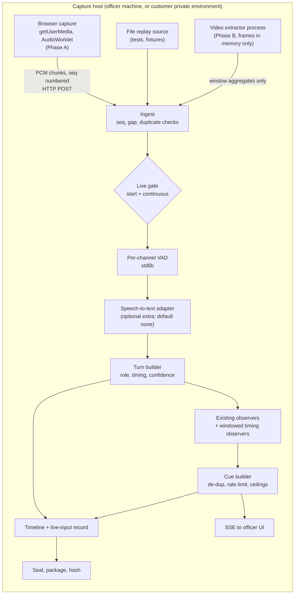
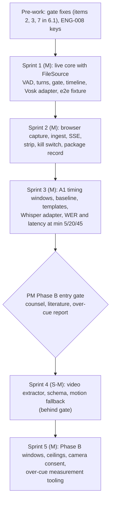

# Live Audio and Video Cues — Engineering Design

**Product:** CueLiez (Cue + Legal Interview Engine)
**Status:** Design v1, 2026-11-11. Realtime and Audio Engineer. Designs against `docs/design/LIVE_AV_PRODUCT_SCOPE.md` (PM) and `docs/OWNER_DECISIONS.md` section 2a. Nothing in this document is built. No production code was written for it; measurement spikes live outside the repo.
**Never-claim paragraph:** unchanged and binding (`docs/OWNER_DECISIONS.md` section 1). This design makes no accuracy statement of any kind about what any indicator means.

Evidence tags used throughout: **[M]** measured on this machine during this sprint; **[E]** estimate, reasoning only, not run; **[N]** cannot be tested here (needs a real microphone, camera, room, or counsel).

---

## 0. Summary and recommendations

| Question | Recommendation | Basis |
|---|---|---|
| Where is audio captured? | Phase A: in the officer's browser (`getUserMedia`, AudioWorklet to 16 kHz PCM) on the capture host, with a replay-from-file source for tests. Local device process (ffmpeg/arecord subprocess) is the documented alternative. | Section 2.2 |
| Where is video captured and processed? | Phase B: a local extractor process on the capture host. Frames stay inside that process. Only whitelisted window aggregates leave it. | Section 2.2, 2.5 |
| Transport into Python | Standard library only: HTTP/1.1 chunk ingest (POST, sequence numbered, idempotent) plus Server-Sent Events out. No WebSocket. `TCP_NODELAY` is mandatory. | [M] Section 2.3 |
| Speech-to-text default | None installed by default. Recommended first adapter: **Vosk** (streaming, Apache-2.0). Alternative behind the same interface: **faster-whisper** (MIT). | [M] Section 3.1 |
| Video features | **MediaPipe Face Landmarker 0.10.x** (Apache-2.0) for off-camera gaze, blink and movement. Fallback and no-ML first step: **OpenCV motion only**. | [M] Section 3.2 |
| Core package | `dependencies = []` unchanged. Everything above is an optional extra. Only the VAD, turn builder, transport, gates and timeline are core, and they are stdlib-only. | [M] stdlib VAD runs at 0.0009 real-time factor |
| Latency | On a paced, real-time, two-channel fixture, the cue appeared 0.84 to 0.87 s after the end of the triggering utterance. Dominant term: the 0.8 s end-of-turn hold. | [M] Section 4 |
| Largest risks | Gate gaps found in the existing code (Section 6.1), the existing stream path's data-loss and cue-semantics behaviour (Section 5.8), no real-device testing possible here, no Python 3.13 wheel for the video extractor. | Sections 5, 6, 8 |

Phase A0 can start now. Phase B stays behind the PM entry gate. Sprint sizing is in Section 7.

---

## 1. Evidence base

**Machine [M]:** 4 vCPU aarch64 container (Ubuntu 22.04.5, Python 3.11.17, 8 GB RAM, no GPU, no audio device, no camera, no `/dev/snd`, no `/dev/video*`). Network was open for installs and model downloads only. All timings are CPU-only on this machine. A customer workstation will differ; every number is a statement about this machine, not a guarantee.

**Test media** (all synthetic or public domain; no real person's footage):

| Media | Source | Licence | Use |
|---|---|---|---|
| `jfk.flac`, 11 s speech | OpenAI Whisper repo test asset (1961 US government speech) | Public domain (US government work) | STT latency and throughput. Concatenated with inserted digital silence of 2.0, 0.7 and 4.0 s (50.7 s) and repeated to 210.8 s. |
| Noisy variants | The above plus ffmpeg synthetic pink noise at three amplitudes | Synthetic | Energy-VAD robustness. Noise level is the ffmpeg amplitude parameter, not a measured SNR. |
| `interview_stereo.wav`, 62.6 s, 2 channels | Rendered here from `docs/examples/owner_conflict_interview.json` with the Piper TTS engine, officer on channel 0 (male voice), subject on channel 1 (female voice), known gaps, one deliberate 4.5 s subject delay | Script is owner-synthetic. **The two voices are CC BY-NC-SA 4.0 (Hi-Fi Captain).** The audio was used only in scratch and must not be committed. | End-to-end paced run. |
| `synth_face.mp4`, 30 s, 15 fps, 640x480 | Drawn with OpenCV shapes (cartoon face), scripted: 7 blinks of 4 frames, off-centre iris 10 to 14 s and 22 to 25 s, head movement 16 to 19 s | Synthetic | Video throughput and scripted-event recovery. |

**What the video media can and cannot show [M/N]:** a cartoon face exercises the whole pipeline and has known ground truth for scripted events. It says nothing about real faces, glasses, lighting, skin tone, head coverings or camera placement. Cost on real faces is an **[E]** (the model input size is fixed, so cost should be similar; unverified).

Spike scripts are kept outside the repository at `/workspace/spikes/live-av-2026-11-11/scripts/` (agent workspace, not in git).

---

## 2. Architecture

### 2.1 Overview



Principles:
1. **Capture is dumb, the engine is strict.** The engine never trusts the capture side for gate state. Every chunk is accepted only while the engine's own gate check passes.
2. **Media time is the clock.** All timestamps in the engine and the package are milliseconds of media time since the session's live start, derived from sample counts and frame timestamps. Wall time is recorded beside it, for latency measurement only.
3. **Only finals reach observers and cues.** Partial text goes to the caption view only (scope, product answer 1).
4. **Every interruption is a record, never a silent repair.**
5. **Core stays stdlib.** Optional engines load lazily, and the live command names the missing extra when one is absent (scope acceptance A0-9).

### 2.2 Capture: where, and why

| | Browser capture (getUserMedia) on the capture host | Local device process (ffmpeg or arecord subprocess, or PortAudio) |
|---|---|---|
| Audio device access | Browser asks for permission and shows its own "microphone in use" indicator, which supports the "no covert capture" rule. | No platform prompt on Linux. The strip is the only indicator. |
| Native dependency | None. | ffmpeg/arecord binary (stdlib `subprocess`), or PortAudio. **[M] `sounddevice` fails here: `PortAudio library not found`.** |
| Kill switch | Officer UI calls `track.stop()` and the engine stops accepting; two independent stops. | Engine terminates the subprocess. |
| Officer UI fit | Same page as the cue view and live-inputs strip. | Separate process to supervise. |
| Browser caveats | Needs a secure context (`localhost` qualifies; any other host needs HTTPS). Echo cancellation, auto gain and noise suppression must be set off (they alter energy and pauses). Tab must stay open. | Platform-specific device strings. |
| Frames for video | Would put camera frames in a JavaScript page. | Frames stay in one process we can test. |

**Decision.**
- **Phase A (audio): browser capture.** It reuses the officer page, needs no native library, and the browser's own device indicator backs the scope's "no hidden mode" rule. The AudioWorklet downsamples to 16 kHz mono (or 2 channel) signed 16-bit PCM and posts 100 ms chunks.
- **A `CaptureSource` interface** hides this from the engine. The engine sees `open()`, `close()`, and chunks. Implementations: `BrowserIngestSource` (Phase A), `FileSource` (tests, fixtures, the end-to-end test), `ProcessSource` (ffmpeg or arecord; documented alternative, optional).
- **`open()` is called only after the gate passes.** For the browser, `open()` mints a one-time session ingest token, and the page calls `getUserMedia` only after it receives that token. The engine rejects any chunk without a valid token. So refusal means the device is never opened by the page and the engine ingests nothing. The "fake source records zero opens" test (scope A0-1) targets `open()`.
- **Phase B (video): local extractor process on the capture host.** Camera frames never cross a socket or leave process memory. Only window aggregates are posted to the engine, so the scope rule "never transmitted off the capture host" holds even when the engine runs elsewhere. A browser-side JavaScript extractor is a possible later alternative, but the "frames not stored or sent" guarantee would then rest on page code, and I did not measure it **[N]**.

**Split deployment [E, needs a PM answer]:** if the engine runs on a different machine than the officer's browser, audio crosses the customer's network. The scope allows services inside the customer's own environment by explicit configuration. I need a decision that LAN-internal audio transport with TLS counts as "off the capture host but inside the customer environment" for audio. Video never moves in either case (above).

### 2.3 Transport

**Choice: HTTP/1.1 chunk ingest plus Server-Sent Events, stdlib only.** No WebSocket: the standard library has no server implementation, and a hand-written RFC 6455 layer adds code and attack surface with no measured benefit.

Measured with a stdlib `ThreadingHTTPServer` on loopback, 100 ms chunks of 3,200 bytes at real-time pace for 600 chunks **[M]**:

| Quantity | Result |
|---|---|
| POST round trip, p50 / p99 / max | 0.37 / 0.50 / 0.88 ms |
| SSE push delay, p50 / p99 | 0.19 / 0.25 ms |
| Delivered, in order | 600 of 600, in order |
| Back-to-back POST throughput, default sockets | **20 chunks/s** |
| Back-to-back POST throughput, `TCP_NODELAY` both sides | **8,392 chunks/s** |

The 20 chunks/s figure is the Nagle plus delayed-ACK stall (the stdlib sends headers and body in separate writes). It does not appear at the paced 10 chunks/s rate, but it caps any test harness or forwarder that sends faster than real time. Rule: the ingest server sets `TCP_NODELAY` on every accepted socket and the client does the same; the end-to-end test feeds the engine in-process, not over HTTP.

Protocol sketch (a proposal, to be fixed in code and tests):

```
POST /live/v1/<session>/audio           headers: X-Ingest-Token, X-Chunk-Seq, X-Sample-Rate, X-Channels
     body: PCM s16le, one chunk (100 ms, 3,200 B mono or 6,400 B stereo)
     200 {"ack": <seq>}            accepted
     200 {"ack": <seq>, "dup": true}   same seq and same length: no-op (idempotent resend)
     409 {"expected": <seq>}       gap or conflicting duplicate; recorded
     403 {"error": "<gate code>"}  gate failed; chunk dropped; recorded
GET  /live/v1/<session>/events     text/event-stream; Last-Event-ID resumes
     events: caption (partial or final, marked machine transcript), turn, cue, state, degraded
```

Existing dashboard facts that affect this **[M]**:
- The dashboard page polls `/cues` every 1,000 ms (`setInterval(refresh, 1000)`), which adds 0 to 1,000 ms (mean about 500 ms) to every cue. SSE removes that term.
- `POST /cues` replaces the whole cue list; there is no append, no state channel and no live-inputs strip data.
- The rate limiter allows 120 requests per 60 s for all methods. **The 121st POST received 429.** Chunk ingest at 10/s needs its own limit or exemption.
- Ingest must reuse the dashboard's token and exact local-origin checks (ENG-006).

### 2.4 Speech-to-text adapter interface

The default is **none**. `--live-audio` without an installed adapter exits with a clear error naming the extra.

```python
class SpeechToText(Protocol):
    component_id: str          # e.g. "vosk"
    version: str               # library version
    model_id: str              # e.g. "vosk-model-small-en-us-0.15"
    model_sha256: str          # recorded in the package
    def open(self, *, sample_rate: int, channels: int) -> "SttStream": ...

class SttStream(Protocol):
    def accept(self, channel: int, pcm: bytes, t_start_ms: int) -> list["AsrEvent"]: ...
    def flush(self, channel: int) -> list["AsrEvent"]:   # force a final at an endpoint
    def close(self) -> None: ...

@dataclass(frozen=True)
class AsrEvent:
    kind: Literal["partial", "final"]
    channel: int
    text: str
    t_start_ms: int
    t_end_ms: int
    words: tuple["AsrWord", ...]      # text, start_ms, end_ms, conf or None
    confidence: float | None          # mean word confidence if the engine gives one
```

- **Streaming engines** (Vosk) emit partials and finals themselves. **Segment engines** (faster-whisper) are driven by the engine's VAD: audio is cut at pauses, each segment is decoded when closed, no partials. Both sit behind the same interface.
- **Turn endpointing belongs to the engine, not the adapter.** [M] Vosk's own endpointer split 4 utterances into 13 finals, so an ASR final is not a turn. [M] faster-whisper merged segments across a 0.7 s pause (small.en), so ASR segment gaps cannot supply pause features either. The engine's VAD (Section 2.6) is the single source of turn boundaries and pause timing.
- A customer's own private transcription service is an adapter too, enabled by explicit configuration only, recorded in the package (scope section 5).

### 2.5 Video feature adapter interface

```python
class VideoFeatureExtractor(Protocol):
    component_id: str; version: str; model_id: str; model_sha256: str
    def open(self, *, fps: float) -> None: ...
    def process(self, frame: "FrameBuffer", t_ms: int) -> None:   # frame in memory; discarded on return
    def close_window(self, t_start_ms: int, t_end_ms: int) -> "VideoWindow | None": ...

@dataclass(frozen=True)
class VideoWindow:
    t_start_ms: int
    t_end_ms: int
    frames_total: int
    frames_tracked: int                  # tracking quality = tracked / total
    off_camera_gaze_share: float | None  # 0..1 of tracked frames
    blink_count: int | None
    movement_index: float | None
```

- `VideoWindow` is the **entire output schema**. It has no landmarks, no embeddings, no blendshape names, no per-frame series and no emotion, expression, identity or demographic field. A schema test asserts the field set (scope B-7).
- Frames enter `process()` and are not retained: no list of frames, no disk, no socket. Tested by directory diff and patched sockets (scope B-2); the MediaPipe adapter converts and drops each frame within the call.
- The adapter maps its internal model outputs to the three indicators. [M] On the synthetic video the Face Landmarker's eye-direction and blink scores moved with the scripted events (Section 3.2), but those internal score names must not leave the adapter.
- Window length is a **design parameter [E]**: start at 30 s, set by Phase B's over-cue measurement. Blink counts over very short windows are not meaningful. Windows shorter than a minimum of tracked frames return `None` and the officer sees "Tracking quality too low".

**How output feeds the observers.** Two ordered logs per session: `turns` (finalised turns, with audio-timing fields attached to subject turns) and `windows` (video windows). Existing turn observers keep reading `turns`. Windowed observers (new, ENG-007 wording) read `windows` against an own-baseline. A video cue is anchored to its time window and may list the turn under way as context only (scope 4.2, "coincidence, not response"). `multimodal.py` convergence is not used for video: video cues are not merged into text-cue ranking (scope 4.2, "separate sections").

### 2.6 Turn building, timing features, and feeding the existing paths

Per channel, in the engine (stdlib, no numpy):
1. 20 ms frames, RMS energy, adaptive floor, 200 ms hangover merge. **[M]** 50.7 s of audio in 0.044 s (real-time factor 0.0009), 15 MB peak memory.
2. A turn opens at voiced onset and closes after `T_END` of silence. Default `T_END = 0.8 s` **[M]** (measured turn-final delay median 0.847 s, max 0.92 s). It must exceed the within-answer pause threshold so pauses inside an answer stay inside the turn.
3. Role comes from the channel (two-channel capture). A single mixed channel gives `speaker_unconfirmed` for every turn until the officer confirms roles. Unconfirmed turns are never cue sources (scope 3.4). Diarization is not evaluated here **[N]**.
4. Timing fields attach to the subject turn: `duration_ms`, `response_latency_ms` (subject onset minus the preceding officer turn's last voiced frame), `pause_total_ms` and `pause_count` inside the answer. **[M]** Pause recovery on clean audio: measured gaps 2.06, 0.76, 4.06 s against inserted 2.0, 0.7, 4.0 s (the extra is the source clip's own lead and tail silence plus frame quantisation).
5. Transcript text from the adapter's finals is concatenated into `text`; `asr` metadata (component, mean confidence) rides on the turn.
6. The turn is appended to the session transcript and the **existing** pipeline runs (`ObservationRunner.run` plus `cues_from_observations`), then the cue goes to SSE and into the timeline.

**VAD limits [M]:** clean and low-noise audio recovered the segments. At the highest noise amplitude tested (0.03) the same speech fragmented into 20 segments instead of 4. A real room will be harder than any of this. Cue quality gating on VAD quality (the scope's "tracking or transcription quality passes a threshold") needs a measured rule from owner-recorded sessions **[N]**.

### 2.7 Gate state, per-modality consent, start and continuous checks

**Start (before any source opens):** a single `LiveGate.check_start(state, modalities)` runs, in order:
1. mode is `generic` or `interrogation` (refuse `government`, `clinical`, `therapy`),
2. prohibited uses, base consent per mode, training acknowledgement,
3. live-input training version, adult-with-capacity attestation, consent-text version,
4. per modality: `audio_capture` for microphone and transcription, `audio_features` for timing indicators, `camera` for video. Each needs consent, attester, jurisdiction and jurisdiction approval.

Any failure: nothing opens, an audit event and a timeline refusal record carry the gate error code, exit code 2.

**Continuous:** the same per-modality check runs
- on every ingest batch (cost is dictionary lookups; negligible next to the 100 ms chunk period),
- at each turn finalisation and window close,
- on a 1 s heartbeat tick, so a withdrawal is seen even when no chunk arrives.

**Fail closed mid-stream.** On any failed continuous check, or an officer or subject stop:
1. that modality stops at once: the source is closed, in-flight buffers and any open turn are discarded (not finalised), no further cue is produced from it;
2. a timeline event `{modality, event: "gate_fail" | "officer_stop" | "subject_withdrew" | "fault", code, t_media_ms, t_wall}` is appended;
3. the strip shows `STOPPED BY OFFICER` or `DOWN`, with the reason code;
4. other modalities continue only if their own checks still pass; the session can still seal;
5. a restart is a new `start` event with a new segment id, after a fresh start check.

Cues already shown stay in the record. A stop is a human action, never an end of the interview.

**Dependence on gate changes:** revocation needs a gate API (Section 6.1, items 3 and 4); the existing code cannot express it.

### 2.8 What the sealed package gains

A `live_inputs` block (top-level keys fall inside the hashed area today, **[M]** by reading `_canonical_json_for_hash`; the Gates and Seal Engineer owns the final schema):
- per-segment timeline: start, stop, officer stop, gate failure, stall, restart, each with reason code, media time, wall time;
- components: id, version, model id and model checksum for the speech-to-text and video extractors;
- capture config: sample rate, channels, browser constraints applied (echo cancellation, gain, noise suppression off), chunk size, `T_END`, window length;
- quality counters: chunks received, duplicates, gaps and gap-filled ms, dropped ms, stalls, per-turn transcription confidence, count of turns with `speaker_unconfirmed`;
- `live_cues_shown`: every cue shown to the officer with its `cue_id`, evidence snapshot and shown time (Section 5.8 explains why);
- consent form text version and the agency recording reference (identifier and hash) if the officer supplies one.

No audio samples, frames, landmarks or per-frame series, ever.

---

## 3. Dependency evaluation (measured)

All installs in throwaway virtual environments under `/tmp/spike`. Sizes are `du` of the environment. "RTF" is processing time divided by audio duration (below 1 is faster than real time).

### 3.1 Speech-to-text

| | **Vosk 0.3.45** + `vosk-model-small-en-us-0.15` | **faster-whisper 1.2.1** (CTranslate2 4.9.0, int8) |
|---|---|---|
| Licence | Library Apache-2.0 (package classifier); model licence not verified here | Library MIT; CTranslate2 MIT; Whisper weights MIT (Systran conversions) |
| Install size [M] | environment 13 MB (`libvosk` 8 MB); model 41 MB zip, 68 MB unpacked | environment 313 MB; models `tiny.en` 73 MB, `base.en` 139 MB, `small.en` 462 MB |
| Pulls in | cffi, requests, tqdm, srt, websockets (package metadata) | PyAV (`av`, bundles FFmpeg libraries), onnxruntime, tokenizers, huggingface-hub, numpy |
| Streaming semantics | True streaming: partials and finals | Not streaming: decode per closed segment, no partials |
| Model load [M] | 0.28 s | `tiny.en` 1.6 s, `base.en` 2.4 s, `small.en` 10.6 s |
| Peak memory [M] | 194 to 209 MB | `tiny.en` 459 MB, `base.en` 793 MB, `small.en` 2,133 MB |
| Throughput [M] | RTF 0.045 (50.7 s), 0.032 (210.8 s) | see per-utterance row |
| Latency to a final after the speaker stops [M] | Vosk's own endpointer emitted a final about 0.9 to 1.0 s of audio after the last word ended; per 100 ms chunk p50 0.23 ms, p95 9 to 18 ms, max 112 to 119 ms | Decode of one 11 s utterance, 4 threads: `tiny.en` 0.46 s, `base.en` 0.76 s, `small.en` 2.3 to 2.4 s. 1 thread: 0.94, 1.91, 6.4 s. Word timestamps add 0.03, 0.08, 0.23 s |
| Output [M] | Words with start, end, per-word confidence; lower-case, no punctuation | Segments with text, `avg_logprob`, `no_speech_prob`; optional word times |
| Time-stamp behaviour [M] | First word 0.3 s on the clip | Word start 0.0 s on the same clip (segment start differed from the inserted offsets by up to 0.65 s for `tiny.en`) |
| With video extraction running at the same time [M] | RTF 0.034, video unchanged | `base.en`, 2 threads, 11 s utterance: 1.1 to 1.4 s; video p50 11.1 ms |
| Python 3.10 to 3.13 on aarch64 [M, dependency resolver] | resolves on all four | resolves on all four |

**A hazard found [M]: Whisper's temperature fallback.** On my repeated-sentence 50.7 s file, default decoding took 7.8 s (`tiny.en`) and **72.5 s** (`small.en`, RTF 1.43). With fallback off (`temperature=0.0`) it took 1.2 s and 5.95 s. The default fallback re-decodes segments it considers repetitive, which makes latency unbounded. The adapter must set `temperature=0.0` (and `condition_on_previous_text=False`) for the live path. What that costs in text quality is not measured here.

**Observed output on the end-to-end fixture [M], not an accuracy claim:** Vosk on the 16-turn two-voice synthetic fixture produced 3 word errors in 139 reference words, with clean single-speaker channels and no noise. Do not generalise this. Real word error on owner-recorded speech with accents, noise, cross-talk and disfluency is an open measurement (scope 9.3 gives pilot officers the threshold). The vendor model card quotes its own benchmark figures; I did not reproduce them and do not cite them.

**Disfluencies [N]:** none of my media contained fillers or hesitations, and the owner fixtures have none (0 fillers in 12, 16 and 14 turns). Whether either engine keeps "um" and "uh" is untested, so `FilledPauseMarkerObserver` (counts fillers from text) must be off for machine transcripts until a disfluent recording shows what survives. Lexical hedges ("maybe", "I guess", "I think") are ordinary words and should pass through either engine, also **[N]**.

**Recommendation.** First adapter: **Vosk**, because it is the only candidate here with true streaming semantics, a 13 MB environment, RTF about 0.03 to 0.05, about 200 MB of memory, and a final within about a second of speech end. Alternative behind the same interface: **faster-whisper `base.en`**, int8, 2 to 4 threads, VAD-segmented, fallback off, for sites that prefer its model. The A1 sprint includes a word-error comparison of both on owner-recorded fixtures before anyone treats the default as settled. Not evaluated: whisper.cpp, sherpa-onnx, larger Whisper models, GPU paths (time, not blocked).

### 3.2 Video feature extraction

| | **MediaPipe Face Landmarker 0.10.18** + `face_landmarker.task` | **OpenCV only** (opencv-python-headless) |
|---|---|---|
| Licence | MediaPipe Apache-2.0 (package metadata); OpenCV Apache-2.0; model card licence not verified here | Apache-2.0 (package metadata) |
| Install size [M] | **800 MB** with default dependencies (jaxlib 296 MB, scipy 92 MB, two OpenCV builds). **263 MB** with `--no-deps` plus `absl-py`, `attrs`, `flatbuffers`, `numpy<2`, `protobuf<5`, `opencv-python-headless`, `matplotlib`: same outputs on the probe. Model 3.76 MB | 143 MB (numpy and cv2) |
| Inference [M] | p50 10.8 ms, p95 10.9 ms, max 15.0 ms per frame, so up to about 92 frames/s on one stream at 640x480; same at half size (input resized internally) | Frame difference 0.04 ms; Farneback optical flow at 160x120 2.58 ms |
| Memory [M] | 180 MB peak | 83 MB peak |
| Detection on synthetic face [M] | 450 of 450 frames, 478 landmarks, blendshape scores | n/a (no face or gaze model) |
| Scripted-event recovery [M] | Eye-direction score 0.72 on scripted off-centre frames against 0.085 elsewhere; blink score 0.177 on closed frames against 0.001 open (weak absolute value on cartoon eyes); landmark-centroid step 0.010 moving against 0.000 still | Frame-difference mean 1.154 moving against 0.044 still; flow magnitude 0.258 against 0.006 |
| Python | **No `cp313` wheel for 0.10.18** [M, resolver]. Resolves for 3.10 and 3.12 | Resolves for 3.10 to 3.13 |
| Blocker found [M] | Newer **1.2.2** fails to import here: `libEGL.so.1: cannot open shared object file` (system library, no root). Unknown whether installing that library fixes it **[N]** | none |

**Not run:** OpenFace (the project licence is restrictive, from memory, unverified), dlib (needs a compiler toolchain), py-feat (large deep-learning stack). Not blocked by measurement; not pursued.

**Recommendation.** Phase B primary: MediaPipe Face Landmarker 0.10.x in the extractor process (`python_version < '3.13'`). The extractor adapter hides model internals behind `VideoWindow`. No-ML first step, useful before Phase B opens: OpenCV movement index only (no gaze, no blink). The extractor can run in its own virtual environment, which also avoids a numpy pin clash with the Whisper extra [E].

**Extras proposal** (`dependencies = []` unchanged; versions are those measured, ranges to be set when built):

```toml
[project.optional-dependencies]
live-audio         = ["vosk>=0.3.45,<0.4"]
live-audio-whisper = ["faster-whisper>=1.2,<2"]
live-video         = ["mediapipe==0.10.18; python_version < '3.13'", "opencv-python-headless>=4.8"]
live-video-motion  = ["opencv-python-headless>=4.8"]
```

Honest limits of that block: `pip install .[live-video]` pulls the full 800 MB dependency set; the 263 MB recipe needs `--no-deps` and cannot be expressed as an extra, so it would be documented as an install note. Model files are downloaded or supplied separately, and their checksums are recorded in the package. The FFmpeg libraries bundled in PyAV carry their own licences; that needs a legal read before distribution **[N]**.

---

## 4. Latency budget

Reference hardware: the machine in Section 1. "Utterance end" is the last voiced frame of the triggering answer.

### 4.1 Where the time goes (vosk path)

| Stage | Time | Tag |
|---|---|---|
| Capture chunking (100 ms chunks, chunk completes after the speech it contains) | 0 to 100 ms, mean about 50 | [E] by construction |
| Browser to engine transport | under 1 ms (POST p50 0.37 ms) | [M] |
| End-of-turn hold `T_END` | **800 ms** (design parameter) | [M] set value, observed 0.82 to 0.92 s |
| ASR finalisation at the endpoint | typically 0.2 ms per chunk; up to 119 ms at an endpoint (vosk, max seen) | [M] |
| Observers plus cue build | 0.3 to 2.8 ms in the paced run; see growth below | [M] |
| Engine to browser (SSE push) | 0.2 ms | [M] |
| Browser display (today's page polls every 1,000 ms) | 0 to 1,000 ms until SSE is used; near 0 after | [M] code path, [E] browser render time |

**Observed end to end [M]:** paced real-time run, 16 turns, two channels, Vosk, engine VAD, existing default observers, 3 cues surfaced. Cue emitted **0.841, 0.856 and 0.872 s** after the utterance end. Turn-final delay over all 16 turns: median 0.847 s, max 0.92 s. Observer pass at most 2.8 ms. This excludes browser render and today's 1 s poll. With the poll, the worst case is about 1.9 s; with SSE, about 0.9 s. Both are under the PM's 5 s target, which stays a target until the owner-recorded 2-minute fixture is run (scope A0-3). Sample of three cues is small; it is a plumbing proof, not a distribution.

### 4.2 Segment-engine path (faster-whisper)

Final delay is `T_END` plus the decode of the last closed segment: **0.8 + 0.46 s** (`tiny.en`) to **0.8 + 2.4 s** (`small.en`) for an 11 s segment at 4 threads **[M components, E sum]**; at 1 thread `small.en` is 0.8 + 6.4 s. To keep this bounded, long answers are cut at pauses (at most about 10 s per segment) and decoded while the person is still speaking, so only the last segment counts. Under the same pace-and-fallback-off conditions I did not run this as an end-to-end pipeline **[E]**.

### 4.3 Growth with interview length (PM question 6)

The existing path reruns every observer over the whole transcript at each turn **[M]**:

| Turns in transcript (about minute) | `default_runner` | `full_runner` |
|---|---|---|
| 76 (5) | 16.4 ms | 18.8 ms |
| 300 (20) | 63.5 ms | 73.9 ms |
| 676 (45) | 145.6 ms | 168.2 ms |

Turn rate in this table is about 15 turns per minute, from the fixture. Cost per turn grows linearly with length and total work grows quadratically. It is small against the 5 s target, so latency is not at risk, but the PM statement "must not grow" is **not met by the current approach**: it grows from 16 to 146 ms. Recommended for A1: incremental per-indicator state (rolling baseline, O(1) per turn) for the new windowed timing observers; leave existing text observers on the batch path until a measurement says otherwise.

### 4.4 Not measured here

- Kill switch (scope target 1 s): capture stop within one chunk period (100 ms) plus a heartbeat tick (1 s) is a design bound, not an observation **[E, N]**.
- Browser render time, AudioWorklet and device latency, real-microphone buffering: need real devices **[N]**.
- Video latency to a cue is dominated by window length (30 s proposed) rather than compute; compute is about 11 ms per frame **[M]**.

---

## 5. Streaming semantics

### 5.1 Timestamps and ordering
- Media time (ms since live start) is authoritative: `t_ms = sample_index / sample_rate * 1000` per channel, `t_ms` from frame timestamps for video. Chunk `seq` times chunk length gives the expected sample index.
- Within a channel, chunks must arrive in `seq` order. The ingest layer holds at most 3 out-of-order chunks (300 ms) **[E]**, then declares a gap.
- Audio and video clocks are independent; each window and turn carries media time and wall time. Alignment tolerance for context (the turn under way) is 250 ms **[E]**, to be set by measurement in Phase B.

### 5.2 Turn segmentation
As Section 2.6. One turn per channel burst closed by `T_END`. Overlap: both channels voiced at once gives `overlap_ms` on both turns; they finalise independently. Cross-talk bleed between microphones breaks channel-as-role in a real room; my TTS fixture has perfectly separate channels, the best possible case **[N]**.

### 5.3 Partial and final
- Partials go to SSE `caption` events marked `machine transcript` and `partial: true`. They are never fed to an observer, never create a cue, and are not in the package.
- A final is immutable. An officer correction is a separate annotation tied to the turn, never an edit.

### 5.4 Duplicate and replay handling
- Ingest: same `seq` and same length is acknowledged and ignored. Same `seq` with different length is a conflict: rejected with 409 and recorded.
- After ASR: a final whose `(channel, t_start_ms, t_end_ms)` equals an existing turn is dropped.
- A whole-session replay from a file is a different source id; it cannot append to a live session's timeline.

### 5.5 Cue de-duplication
Today `cue_id` is a hash of `(method, turn_index, label, category)` **[M]** by reading `base.py`. It excludes evidence, so a later re-run with a changed baseline cannot update a shown cue. Observed behaviours **[M]**:
- a cue can appear late for an earlier turn (turn 3's speech-rate cue surfaced when the transcript had 12 turns);
- on the three owner fixtures (0, 2 and 8 cues) and one latency fixture I built (28 turns with scripted outliers, 4 cues), the cues shown live and the cues in the final batch were identical in every case. I did not find a case where a shown cue disappeared; I cannot exclude one when the baseline shifts.

Design: dedupe on `cue_id` as today, and record every shown cue (`live_cues_shown`) with its evidence snapshot. At seal, the final batch observations and the shown log are both in the package, and any difference is flagged in the quality counters. The officer never sees a cue vanish from the screen.

### 5.6 Backpressure
Bounded queues; no silent drops.
- Vosk has RTF about 0.03 to 0.05 **[M]**, so 20x or more headroom. `small.en` 4 threads decodes an 11 s segment in 2.4 s **[M]**; 1 thread in 6.4 s.
- If unprocessed audio exceeds 3 s **[E threshold]**: state `degraded: transcription behind`, cues from that input pause, officer sees it.
- If it exceeds 10 s **[E threshold]**: the oldest unprocessed audio is dropped with a recorded `dropped_ms` and the open turn is marked `truncated`. The microphone cannot be paused, so the engine never silently catches up.
- Ingest returns 503 with `Retry-After` for the file source only; a live browser keeps sending and the engine records.

### 5.7 When transcription or video falls behind or fails
- No chunk for 1 s: `stalled`; 5 s: `DOWN`, cues from that input stop **[E thresholds]**.
- Adapter exception: that modality stops (fail closed), reason `fault` recorded, strip shows `DOWN`. The officer may restart (fresh start check, new segment id) or continue text-only.
- Video window with tracking below a minimum: no cue; state "Tracking quality too low".
- Baseline not complete: state "Not enough baseline yet", no shift cue (scope A1-2).

### 5.8 What the existing stream path does that matters here (read and run)
- A malformed NDJSON line aborts the run with exit code 2, no `stream_end`, **no seal**, and the turns accumulated so far are lost **[M]** (run: two events printed, then error). A live interview must never lose its record on one bad line; the live path seals what it has and records the interruption.
- The final stage ignores `--sign` and `--enable-assisted` (read `_run_stream_turns`) and re-runs the pack or runner from scratch each turn.
- It never calls any modality check (Section 6.1, item 7).

### 5.9 Recording a degraded or interrupted stream
Every item in Sections 5.4 to 5.7 is a timeline event or counter inside the hashed `live_inputs` block (2.8). A reviewer can read from the package: when each input was live, every stop and reason, how many chunks were duplicated, gap-filled, dropped, which turns are truncated, and which cues were shown. Nothing is hidden or silently repaired.

---

## 6. What changes, where, and who owns it

### 6.1 Gaps found in the current code (each verified by reading, and by running where stated)

| # | Finding | Owner |
|---|---|---|
| 1 | No gated key for microphone capture and transcription; `GATED_INPUT_MODALITIES = {audio_features, camera, wearable}` (`gates.py:41`). Filed as ENG-008. | Gates and Seal |
| 2 | **Per-modality jurisdiction approval can be overridden [M].** `require_gated_modality` accepts `rec["jurisdiction_approved"] or state.jurisdiction_approved`. I recorded `audio_features` approved, then `camera` with `jurisdiction_approved=False`; `assert_can_observe(state, ["camera"])` **allowed** it. | Gates and Seal |
| 3 | `record_modality_consent` sets the state-wide `jurisdiction_approved = True` as a side effect, which is the cause of item 2. | Gates and Seal |
| 4 | No withdrawal or revocation API and no revocation record; nothing checks consent age. Needed for `subject_withdrew` (scope 3.7). | Gates and Seal |
| 5 | **The CLI has no way to record modality consent** (no reference to modality in `cli.py`, [M] grep). Only `--consent` for base consent. | Lead (CLI contract) with Gates |
| 6 | `assert_can_observe` does not check mode exclusion, live training version, adult-with-capacity attestation, or consent text version. ENG-008. | Gates and Seal |
| 7 | **Timing, prosody and visual cues fire with no modality consent [M].** I ran `--stream-turns` in `generic` mode with latency, duration, pause, gaze fields on the turns and no consent: `default_runner` surfaced a response-latency cue and a speech-rate cue; `full_runner` added a pause-duration cue. Neither runner consults `audio_features` or `camera` consent. | Lead (runner), Gates |
| 8 | Seal does not require modality consent when audio or video-derived observations are in the package (`consent_rechecked` covers base consent only), and has no `live_inputs` block or timeline. | Gates and Seal |
| 9 | Dashboard: 120 requests/60 s limiter covers POST (**121st POST got 429** [M]); no SSE, no state channel, snapshot-replacing `POST /cues`, 1 s poll. | Officer UI |
| 10 | Dashboard CSP is `default-src 'none'` with script hashes; an AudioWorklet module is loaded by URL, so a script source that permits it is needed, plus a `Permissions-Policy` for microphone and camera. | Officer UI |
| 11 | Visual cue text says "gaze aversion ratio" (ENG-007), and the PM templates require specific wording and caveats. | Lead (ENG-007) |
| 12 | `AUDIO_FEATURE_OBSERVERS` (`audio_path.py`) includes the pitch-variance and voice-feature-shift observers; the scope keeps pitch and voice-quality features out of the live path (response latency, speech rate and pause patterns stay). `AudioStreamHook` re-runs all observers each push and dedupes only on `cue_id`. | Realtime (me) |
| 13 | Stream path data loss on a malformed line (Section 5.8). | Realtime (me), `--stream-turns` |
| 14 | `AudioStreamHook` and `observe_audio_features` are called by nothing in the CLI or any runner. | Realtime (me) |

### 6.2 Changes by module

| Module | Change | Owner |
|---|---|---|
| New `src/cueliez/live/` (`session.py`, `capture.py`, `ingest.py`, `vad.py`, `turns.py`, `stt.py` protocol and registry, `video.py` protocol, `timeline.py`) | Live engine, stdlib only | Realtime (new area, lead to confirm) |
| New optional adapters `live/adapters/{vosk,faster_whisper,mediapipe_video,opencv_motion}.py` | Lazy imports; clear error naming the extra | Realtime |
| `observations/audio_path.py`, `audio_stream.py`, `prosody.py` | Live path uses only latency, speech rate, pause and speaking-time share; prosody observers excluded from live; windowed baseline-relative timing observers with PM templates | Realtime, wording by ENG-007 |
| `observations/modality_gates.py` | Single live gate entry used by engine and observers | Realtime with Gates |
| `cli.py` `--stream-turns` path | Seal-what-you-have on bad input; modality checks; `--sign`; live flags (proposal: `--live-audio SOURCE`, `--live-video`, `--modality-consent MODALITY:ATTESTER`, plus the ENG-008 fields) | Realtime (stream path), Lead (CLI contract) |
| `gates.py`, `session.py` | Items 1 to 4, 6, 8; revocation API; live fields in gate state; timeline in package; seal-time language gate | Gates and Seal |
| `observations/runner.py` | Runner-level modality gating (item 7) | Lead |
| `delivery/dashboard.py` and page | SSE, live-inputs strip, kill control and shortcut, caption view, rate-limit rule for ingest, CSP and Permissions-Policy, AudioWorklet capture script | Officer UI |
| `delivery/audio.py` | No change; spoken cues are not in the live scope | none |
| `pyproject.toml` | Extras block (Section 3.2) | Lead |
| `docs/` | `ADMISSIBILITY_AND_DISCLOSURE.md` update, `SESSION_LIFECYCLE.md`, `docs/schemas` live block | Gates and Seal with PM |

### 6.3 Tests needed

Core, run in CI with no optional extra installed:
1. Consent refusal; fake source `open()` count is zero (A0-1). Mode refusal for the three excluded modes (A0-2). Missing training, attestation or text version (ENG-008 AC3).
2. **Mid-stream gate failure fails closed:** revoke consent while chunks flow; assert the source closes, the open turn is discarded, no further cue, timeline event with code, session still seals.
3. Kill switch: stop mid-turn; no cue after stop; timeline reason code.
4. Ordering: out-of-order within 300 ms is reordered; beyond it is a recorded gap. Duplicate `seq` is idempotent; conflicting duplicate is 409 and recorded. Replay file cannot append to a live timeline.
5. VAD and turn builder on generated PCM: onset, hangover, overlap, pause totals, role from channel, `speaker_unconfirmed` on mono, unconfirmed never a cue source (A0-4).
6. Cue de-duplication and late cue for an earlier turn; `live_cues_shown` matches what SSE emitted.
7. Backpressure with a deliberately slow fake adapter: degraded state at 3 s, dropped_ms and truncated turn at 10 s, no silent loss; test asserts the counters.
8. Adapter fault and watchdog: stall at 1 s, DOWN at 5 s; text-only continues.
9. Package: `live_inputs` in the hashed area, `--verify-package` passes (ENG-008 AC4, AC5); tampering with the timeline breaks the hash.
10. No audio at rest: directory diff of output and temp (A0-7); package scan for sample data. Offline: sockets patched to fail (A0-8). Without the extra: existing suite passes and live command names the missing extra (A0-9).
11. Wording and banned terms in every new string (language test over `live/`).
12. TCP_NODELAY set on accepted sockets; ingest not throttled by the 120/min limiter; throughput test over loopback with the replay source.
13. Transport: SSE `Last-Event-ID` resume.

With an extra installed (CI job per extra, skipped when absent or when the Python version has no wheel):
14. **End-to-end recorded fixture:** a recorded two-channel WAV of the owner script goes through `FileSource`, the real adapter, real VAD, the real observers, SSE and seal; asserts turn count, roles, that the expected cue appears, and that no audio file is written. The fixture must be an owner recording or a voice with a licence that permits redistribution (the voices I used do not). Timing assertion uses a tolerance and runs paced only in a separate non-blocking job.
15. Video: synthetic video fixture through the extractor; output schema whitelist; no frames at rest; patched sockets; tracking-quality state (B-2, B-4, B-7).

### 6.4 What cannot be tested without real devices, or without people
- Microphone and camera capture, permission prompts, device loss, USB unplug, browser tab backgrounding and throttling, AudioWorklet timing, real echo and cross-talk **[N]**. Mitigation, not tested here: headless Chromium with fake device flags in CI.
- Real speech: accents, noise, disfluency, speaker overlap, interpreter use **[N]**.
- Real faces, glasses, lighting, camera position, head coverings **[N]**, and the over-cue measurement (scope B-8).
- Kill-switch latency on a real device **[N]**.
- Consent wording, voluntariness in custody, biometric status of face-derived features **[N]**, counsel only.
- Whether officers find the cue cadence useful or disruptive **[N]**.

---

## 7. Phased implementation plan

Sprint = one lead-dev sprint, sizes are estimates **[E]** (S, M, L).



**Pre-work (Gates and Seal, small):** fix the jurisdiction override and side effect (6.1 items 2 and 3), add `audio_capture`, revocation, live training and attestation fields (ENG-008), runner-level modality gating (item 7). Phase A0 cannot ship until items 2, 3 and 7 are closed; item 7 means timing cues fire today with no consent.

**Sprint 1, Phase A0 core (Realtime, M).** `live/` core, VAD, turn builder, gate integration with a fake gate API shape, timeline, Vosk adapter, `FileSource`, `--stream-turns` seal-what-you-have fix, tests 1 to 11 and test 14 with a licensed fixture. Needs from the PM: the owner-recorded or properly licensed two-voice fixture. Needs from Gates and Seal: the revocation function name and signature.

**Sprint 2, Phase A0 live (Realtime and Officer UI, M).** `BrowserIngestSource`, ingest endpoint with `TCP_NODELAY`, token, rate-limit rule, SSE, AudioWorklet capture page, live-inputs strip, kill control and shortcut, captions view, `live_inputs` block sealed and verified. Acceptance: scope A0-1 to A0-10.

**Sprint 3, Phase A1 (Realtime, M).** Windowed timing observers with PM templates and caveats, baseline rule, priority ceiling, rate limits (ENG-007 wording), faster-whisper adapter, word-error comparison on owner recordings, latency at minutes 5, 20 and 45 on a long fixture, incremental baseline state. Acceptance: scope A1-1 to A1-5.

**Phase B gate (PM and owner).** No code work for video capture before the entry gate in the scope document is met.

**Sprint 4 (Realtime, S-M).** Extractor process, `VideoWindow` schema, MediaPipe adapter and OpenCV motion fallback, tracking quality states, no-frames-at-rest tests, extras CI job.

**Sprint 5 (Realtime and Officer UI, M).** Window observers, lowest-priority ceiling, camera consent path, per-modality stop, over-cue measurement tooling for the PM's report (scope B-1 to B-8).

---

## 8. Risks and open items

| Risk | Detail |
|---|---|
| Gate gaps | Items 2, 3 and 7 in 6.1 are live defects today independent of this feature. |
| No device testing | Everything involving real capture is **[N]**. First true latency and loss figures come from a real room. |
| Video wheels | MediaPipe 0.10.18 has no Python 3.13 wheel; 1.2.2 failed on a missing system library here. The CI matrix includes 3.13, so the video extra is skipped there. |
| Install weight | `live-video` is about 800 MB with default dependencies. |
| Transcription quality | Not measured on realistic speech; disfluency handling unknown; text observers that rely on fillers are affected (`FilledPauseMarkerObserver`) and are turned off for machine transcripts until tested. |
| Fixture licence | The synthetic voices used here are non-commercial licence; a committed fixture needs an owner recording or a permissively licensed voice. |
| Browser constraint | Non-`localhost` deployments need HTTPS; CSP changes must be reviewed by the Officer UI Engineer. |
| Latency claim | The only end-to-end figure is a 3-cue, 16-turn synthetic run. It shows the plumbing, not a distribution. |

**Product questions raised** (also in `DIARY.md`): (1) split deployment: does LAN-internal TLS audio transport count as inside the customer environment; (2) are officer-confirmed roles on a mono channel acceptable for Phase A0 when two-channel capture is unavailable; (3) should `FilledPauseMarkerObserver` stay off for machine transcripts until a disfluent recording is tested.
